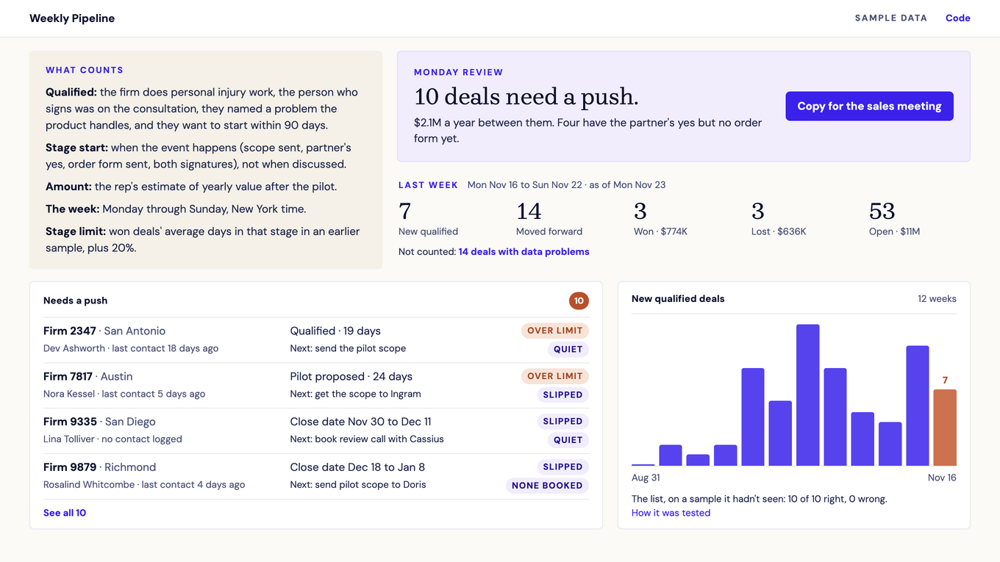

# Weekly Pipeline

A weekly pipeline page on made-up deals. It says what counts first, then shows last week in five numbers, and every number opens to its deals. It also lists the deals that have sat too long, with the owner and the next step.

Finch's Revenue Operations posting asks for "Build a reliable weekly view of pipeline across Finch, with clear definitions and numbers the team can trust." This is a first version of that. Every firm, person, deal and amount here is made up.

On a sample it had not seen, the list named all 10 deals its answer key says need a push, each for the keyed reason, and none it says should not. A separately written recount matched every number.

**The page:** https://duckky153.github.io/weekly-pipeline/



## Try it

```
./run.sh                    # the page at http://127.0.0.1:8765/
./test.sh                   # every test
python3 summaries.py readme # the numbers in this README's two tables, and the cost
```

More: `python3 pipeline.py recount sample/scored` (the engine against the recount, deal by deal), `python3 pipeline.py flip sample/scored --name scored` (every count with the AI's answers flipped), `python3 score.py sample/scored tests/keys/scored.json --name scored`. Python 3 standard library only; no API key is needed, because the AI's answers are saved in `answers/`.

## What it does

It reads a sample export: two weeks of deals, the firms, the team list and the notes, and writes a static page. Run as shown, it connects to nothing and sends nothing; only the notes check, given an API key, sends notes to an AI service.

- **What counts** comes first: what makes a deal qualified, when a stage starts, what an amount means, what the week is, and how long a deal may sit in each stage. The full rules, every edge case included, are in `DEFINITIONS.md`.
- **Last week** in five numbers: new qualified, moved forward, won, lost and open. Each opens to the deals behind it.
- **Not counted.** A deal whose data can't be counted (no owner, no amount, a close date already passed, a skipped stage, the same firm twice, a stage gone backwards, and nine more rules) is left out of every number and off the list, with its reason and who fixes it. `DEFINITIONS.md` calls these held out.
- **Needs a push.** An open qualified deal goes on the list when it is over its stage's limit, its close date moved out 7 or more days since last week, nobody has contacted the firm in over 14 days, or nothing is booked next. Each row has the firm, the owner, the last contact, a status line, the next step and up to two tags, the rules' first (every tag is in its drawer). Deals meeting the most rules come first.
- **The next step** is the deal's own when the notes show it's a real action not yet done; otherwise code picks fixed wording by what the deal waits on, or by its tag and stage.
- **Copy for the sales meeting** copies the list as plain text, with tags, amounts and close dates.

**The stages** are a proposal for a company that sells pilots of an operations service to personal injury firms, each mapped to one of HubSpot's default deal stages, which HubSpot lets you rename ([Set up and manage object pipelines](https://knowledge.hubspot.com/object-settings/set-up-and-customize-pipelines), last updated November 24, 2026):

| Here | HubSpot's default | Starts when |
|---|---|---|
| Consultation booked | Appointment scheduled | a consultation with someone at the firm is booked |
| Qualified | Qualified to buy | the consultation was held with the person who signs |
| Pilot proposed | Presentation scheduled | a pilot scope is sent to the firm |
| Partner said yes | Decision maker bought-in | the owner or managing partner said yes to the scope and price |
| Order form sent | Contract sent | the order form is sent for signature |
| Won | Closed won | the order form has both signatures |
| Lost | Closed lost | the firm said no, or the owner closed it |

The columns follow HubSpot's default deal properties as its page names them (Deal name, Deal stage, Pipeline, Amount, Close date, Deal owner, Create date, Last contacted, Last activity date, Next activity date, Next step, Closed lost reason, and Date entered for each stage), written in lower case with underscores, plus deal and firm IDs ([HubSpot's default deal properties](https://knowledge.hubspot.com/properties/hubspots-default-deal-properties), last updated September 29, 2026).

**Amount** is the rep's estimate of a year's value after the pilot: monthly case volume times price per case times 12. Won therefore counts that yearly estimate, not the pilot's own price. Open value is not weighted.

**The stage limits** (Qualified 11 days, Pilot proposed 16, Partner said yes 15, Order form sent 14) are the average days won practice deals spent in each stage, plus 20%, rounded up, set before the scored sample existed.

**Color.** Rust marks the push count and OVER LIMIT, and also last week's bar, the way the company's own product chart marks its latest bar. The AI's tags are green.

## The AI step

One step uses AI, and on these notes it was not needed: keyword rules found one more planted problem and flagged nothing by mistake. Next time I'd use the rules and keep the AI for notes that don't follow the team's wording. The page shows the AI's tags as they came out, because nothing is switched after the scored read.

A model (Jev, from TypeSafe) reads each open deal's stage, Next step and notes, and answers fixed multiple-choice and yes-or-no questions (`questions.json`): is the Next step a real action, does the latest note say it was done, which stage do the notes say the deal reached, what is it waiting on. It never sees amounts, owners, other deals or any count. Each question is asked twice with the choices reversed, and an answer counts only when both agree.

It never changes a number: a test runs every count with the AI's answers flipped (all yes, all no, and no read at all), and every number and the list come out the same. Everything else is code.

## How it was tested

- **Two samples, keys first.** A separate AI helper wrote a practice sample and a scored sample, 120 deals each, from written rules (`sample/RULES.md`), each with an answer key written alongside (`tests/LABELING.md`). The code was built on practice. The scored sample was not opened until every file that decides a number, a tag or a score was fingerprinted in `lock.json`. It was then read once, and once more for the repeat row.
- **Planted problems.** Practice planted rules H1 to H8. The scored sample planted H1 to H9 and H12 to H15 (H3 twice); H9 and H12 to H15 were new to it. H10 and H11 are tested on an 89-deal test export that breaks and passes every rule once.
- **The recount.** A second script, written by a separate AI helper from `DEFINITIONS.md` alone without seeing the engine, recounts every number from the raw files. It agrees with the engine and the key on every deal and number of both samples, and with the answers worked from the rules in `tests/fixture/expected.json`. This is a check, not a score.
- **A model from a different AI company** wrote the notes of 15 scored deals with its own hard cases and key (an AI reader agreed on 59 of 60 fields), and labeled 20 other deals' notes from the rules alone (71 of 80 fields agreed). Another AI reader settled the 10 differences from the rules (9 from the 20, 1 from the 15): 1 changed the key (`tests/key-changes-before-lock.md`).

| Scored sample, 120 deals | Result | Bar set before the read |
|---|---|---|
| Push list: right deals for the right reason | 10 of 10 | at least 9 of 10 |
| Push list: deals listed that should not be | 0 | 0 |
| Data problems caught for the right reason | 14 of 14 | at least 13 of 14 |
| Clean deals left out by mistake | 0 | 0 |
| Notes: planted problems found | 27 of 31 | at least 3 in 4 |
| Notes: flags that were wrong | 2 of 88 | at most 1 in 20 |
| "Waiting on" answers wrong | 2 of 24 | at most 1 in 10 |
| "Waiting on" answered, of deals that say it | 24 of 57 | at least 2 in 3 |
| Repeat read: answers that changed | 5 of 88 | at most 1 in 20 |

| Notes, 60 open deals with notes | AI | Keyword rules, no AI |
|---|---|---|
| Planted problems found | 27 of 31 | 28 of 31 |
| Flags that were wrong | 2 of 88 | 0 of 87 |
| "Waiting on" answered, wrong | 24 of 57, 2 wrong | 40 of 57, 1 wrong |
| The 15 written by the other company's model: found, wrong flags | 6 of 8, 2 | 7 of 8, 0 |

- **On these notes, keyword rules did as well; the AI adds nothing here.** The keyword rules (`baseline.py`) were written by an AI helper from the labeling rules without seeing any deal, and given the same two practice rounds from counts alone.
- **Two bars missed:** "waiting on" answered for 24 of 57 deals (bar 2 in 3), where the next step then falls back to the tag's wording; and 5 of 88 answers changed on the repeat read (bar 1 in 20).
- **The two wrong flags.** Firm 4293, Next step "Prepare Dec 10 check-in", note "Vida asked me to come back after Dec 10. I set a Dec 1 task to prepare that check-in.": tagged NOT A STEP, though it is a real step. Firm 2488, Next step "Pilot scope sent", note "I sent Colette a pilot scope...": tagged STEP DONE; the key says NOT A STEP, since the field holds a status. The four misses are in `runs/scored.json`; one shows on the page: Firm 7449's next step still says to send the revised order form, which its latest note says was already sent.
- **Not scored:** the other company's model was also asked for its own 40-deal sample. In 31 of its 40 rows each row has one more cell than the header, so the dates after it sit a column off; a second attempt, asked to count its cells, still had 5 rows off and is not in the repo. Repairing it would mean guessing what was meant. The first attempt is in `sample/other/`.
- **Cost:** $0.028 for every AI read in the build (542 requests), under a $0.50 cap checked before each one.

## How it was made

AI wrote the plan, the code and the samples from written rules, and AI reviewers checked each step. `HOW-IT-WAS-BUILT.md` says what was done at each step, `DECISIONS.md` why each choice was made, and `CHANGES.md` what changed after reviews.

## What I'd change next

- **Put deals past their close date on the list,** first, instead of only leaving them out of the numbers: they are often the stalest live deals.
- **Add last week to this week:** last week's open value, plus new qualified, minus won and lost, plus amount and stage changes, equal to this week's, each part clickable, with the change shown under each number. It needs its own definition and its own recount first.
- **Two amounts:** the pilot's price at Won, and the yearly value once the firm converts.
- **Make Qualified checkable:** add the four Qualified checks as deal fields and flag a Qualified deal missing any of them. Today the stage is trusted as the rep set it.
- **Catch placeholder amounts:** a $600 deal is counted in Open today; flag any amount below the smallest real deal (here $48K: 10 cases a month at $400, for a year).
- **Use keyword rules for these note checks,** and ask "what is it waiting on" without the extra yes-or-no question.
- **Conversion by stage** (of deals that entered a stage in a period, the share that reached the next) and **coverage** (open value due in a period over that period's target) are left out; each needs its definition on the page first.

## What it doesn't do

- It uses made-up deals, two weekly exports and one pipeline; no real HubSpot account, export or API. A second offering would need its own pipeline.
- The answer keys were written by the same AI helper that wrote the samples, from the same rules, so a score here means the code follows the written rules, not that the rules fit a real team.
- The stages, the Qualified checks and the limits are a starting proposal. Amount is the rep's estimate; nothing is forecast.
- The notes were written by AI. Real reps' notes are shorter, messier and often missing.
- The page shows a saved run; it can't be pointed at another export from the browser.
